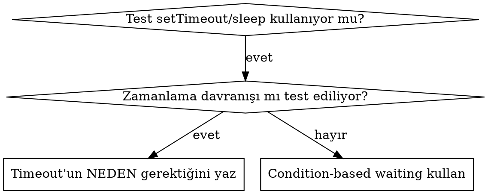

# Condition-Based Waiting

## Genel bakış

Flaky testler zamanlamayı çoğu zaman keyfi gecikmelerle tahmin eder. Bu, hızlı makinelerde geçen ama yük altında veya CI'da fail eden race condition'lar yaratır.

**Temel ilke:** Ne kadar süreceğine dair bir tahmini değil, gerçekten önemsediğin koşulu bekle.

## Ne zaman kullanılır



**Şu durumlarda kullan:**
- Testlerde keyfi gecikmeler varsa (`setTimeout`, `sleep`, `page.waitForTimeout`)
- Testler flaky ise (bazen geçiyor, yük altında fail ediyor)
- Testler paralel çalıştığında timeout oluyorsa
- Async işlemlerin tamamlanması bekleniyorsa (fetch, STOMP mesajı, state güncellemesi)

**Şu durumlarda kullanma:**
- Gerçek zamanlama davranışını test ediyorsan (debounce, throttle aralıkları, geri sayım sayacı) — bunun için fake timer kullan (`vi.useFakeTimers()`)
- Keyfi timeout kullanıyorsan NEDEN'ini her zaman yaz

## Temel pattern

```typescript
// ❌ ÖNCE: Zamanlamayı tahmin etmek
await new Promise(r => setTimeout(r, 50));
const result = getResult();
expect(result).toBeDefined();

// ✅ SONRA: Koşulu beklemek
await waitFor(() => getResult() !== undefined);
const result = getResult();
expect(result).toBeDefined();
```

## Bu projenin araçlarıyla

Kendi polling fonksiyonunu yazmadan önce yığındaki hazır araçları kullan:

| Araç | Koşul bazlı bekleme |
|------|---------------------|
| React Testing Library | `await screen.findByRole('listitem', { name: 'Ayşe' })` (findBy* = waitFor + getBy*) |
| React Testing Library | `await waitFor(() => expect(onSubmit).toHaveBeenCalledTimes(1))` |
| React Testing Library | `await waitForElementToBeRemoved(() => screen.queryByText('Yükleniyor…'))` |
| Vitest | `await expect.poll(() => store.getState().hits.length).toBe(10)` |
| Vitest (zaman davranışı) | `vi.useFakeTimers()` + `await vi.advanceTimersByTimeAsync(1000)` |
| Playwright | Web-first assertion'lar: `await expect(page.getByRole('listitem')).toHaveCount(2)` — auto-wait yapar |
| Playwright | `await page.waitForResponse(r => r.url().includes('/api/workspaces/42/search') && r.ok())` |
| Backend (JUnit) | Awaitility: `await().atMost(5, SECONDS).until(() -> queue.size() == 1)` veya `BlockingQueue.poll(timeout)` |

**Playwright'ta `page.waitForTimeout()` kullanma** — `e2e-testing` skill'i de bunu flaky test kaynağı olarak işaretler.

## Hızlı pattern'ler

| Senaryo | Pattern |
|---------|---------|
| Event bekle | `waitFor(() => events.find(e => e.type === 'DONE'))` |
| State bekle | `waitFor(() => machine.state === 'ready')` |
| Sayı bekle | `waitFor(() => items.length >= 5)` |
| Karmaşık koşul | `waitFor(() => obj.ready && obj.value > 10)` |

## Implementation (hazır araç yoksa)

Genel polling fonksiyonu:
```typescript
async function waitFor<T>(
  condition: () => T | undefined | null | false,
  description: string,
  timeoutMs = 5000
): Promise<T> {
  const startTime = Date.now();

  while (true) {
    const result = condition();
    if (result) return result;

    if (Date.now() - startTime > timeoutMs) {
      throw new Error(`Timeout waiting for ${description} after ${timeoutMs}ms`);
    }

    await new Promise(r => setTimeout(r, 10));
  }
}
```

## Yaygın hatalar

**❌ Çok hızlı polling:** `setTimeout(check, 1)` — CPU israf eder
**✅ Fix:** Her 10ms'de bir poll et

**❌ Timeout yok:** Koşul hiç sağlanmazsa sonsuza kadar döner
**✅ Fix:** Her zaman açık bir hata mesajıyla timeout ekle

**❌ Bayat veri:** State'i döngüden önce cache'lemek
**✅ Fix:** Taze veri için getter'ı döngü içinde çağır

**❌ RTL'de `waitFor` içinde side effect:** `waitFor(() => { fireEvent.click(btn); expect(...) })` — callback tekrar tekrar çalışır
**✅ Fix:** Etkileşimi `waitFor` dışında yap, içinde sadece assertion bırak

## Keyfi timeout'un DOĞRU olduğu durum

```typescript
// Tool her 100ms'de tick atıyor - kısmi çıktıyı doğrulamak için 2 tick gerekli
await waitForEvent(manager, 'TOOL_STARTED'); // Önce: koşulu bekle
await new Promise(r => setTimeout(r, 200));   // Sonra: zamanlı davranışı bekle
// 200ms = 100ms aralıklarla 2 tick - belgelenmiş ve gerekçeli
```

**Gereksinimler:**
1. Önce tetikleyici koşulu bekle
2. Tahmine değil, bilinen zamanlamaya dayan
3. NEDEN'ini açıklayan tek satırlık yorum (koddan çıkarılamayan bir neden olduğu için yorum politikasına uygundur)

## Gerçek dünyadaki etkisi

Bir debugging oturumundan:
- 3 dosyada 15 flaky test düzeltildi
- Geçme oranı: %60 → %100
- Çalışma süresi: %40 daha hızlı
- Artık race condition yok
