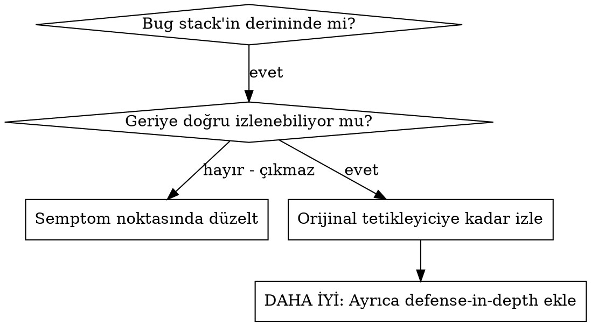
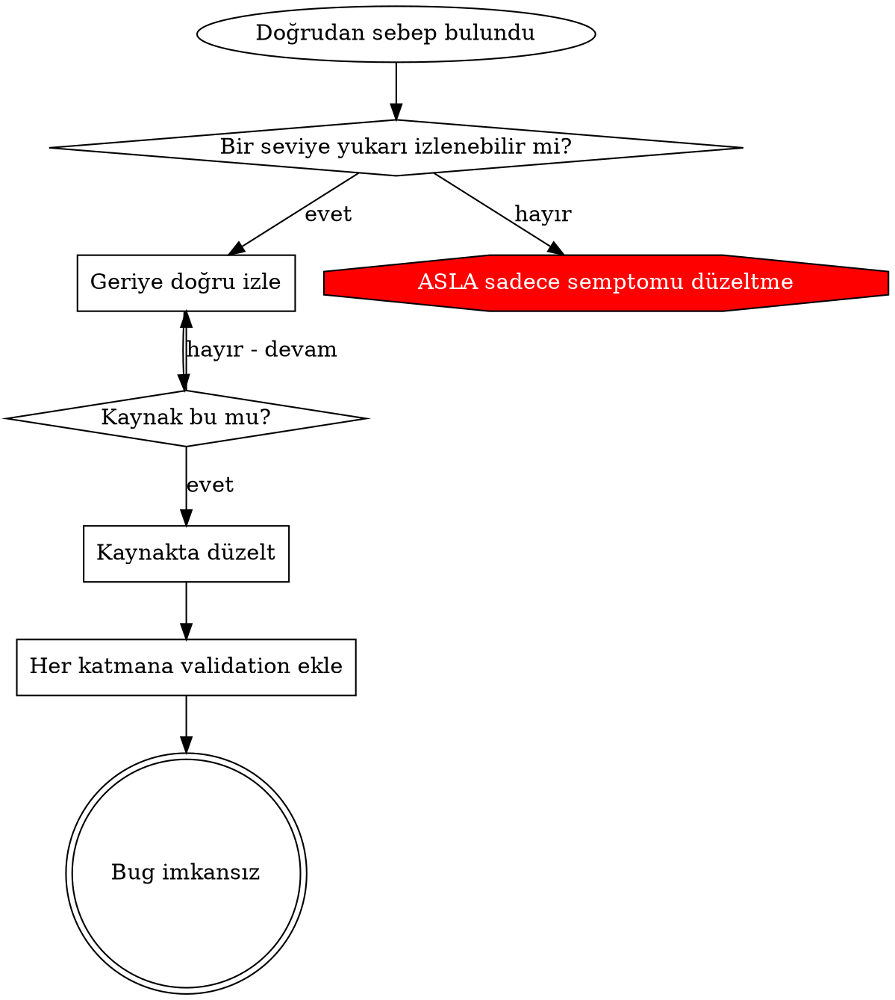

# Root Cause Tracing

## Genel bakış

Bug'lar çoğu zaman call stack'in derinlerinde ortaya çıkar (yanlış dizinde `git init`, yanlış yerde oluşturulan dosya, yanlış path ile açılan veritabanı). İçgüdün hatanın göründüğü yerde düzeltmektir, ama bu semptomu tedavi etmektir.

**Temel ilke:** Orijinal tetikleyiciyi bulana kadar call chain boyunca geriye doğru izle, sonra kaynakta düzelt.

## Ne zaman kullanılır



**Şu durumlarda kullan:**
- Hata execution'ın derinlerinde oluyorsa (entry point'te değil)
- Stack trace uzun bir call chain gösteriyorsa
- Geçersiz verinin nereden geldiği belirsizse
- Sorunu hangi test/kodun tetiklediğini bulman gerekiyorsa

## İzleme süreci

### 1. Semptomu gözlemle
```
Error: git init failed in ~/project/packages/core
```

### 2. Doğrudan sebebi bul
**Bunu doğrudan hangi kod yapıyor?**
```typescript
await execFileAsync('git', ['init'], { cwd: projectDir });
```

### 3. Sor: Bunu kim çağırdı?
```typescript
WorktreeManager.createSessionWorktree(projectDir, sessionId)
  → Session.initializeWorkspace() tarafından çağrıldı
  → Session.create() tarafından çağrıldı
  → Project.create() içindeki test tarafından çağrıldı
```

### 4. Yukarı doğru izlemeye devam et
**Hangi değer geçildi?**
- `projectDir = ''` (boş string!)
- `cwd` olarak boş string `process.cwd()`'ye çözülür
- Bu da kaynak kod dizinidir!

### 5. Orijinal tetikleyiciyi bul
**Boş string nereden geldi?**
```typescript
const context = setupCoreTest(); // { tempDir: '' } döner
Project.create('name', context.tempDir); // beforeEach'ten önce erişildi!
```

## Stack trace eklemek

Elle izleyemediğinde instrumentation ekle:

```typescript
// Sorunlu işlemden önce
async function gitInit(directory: string) {
  const stack = new Error().stack;
  console.error('DEBUG git init:', {
    directory,
    cwd: process.cwd(),
    nodeEnv: process.env.NODE_ENV,
    stack,
  });

  await execFileAsync('git', ['init'], { cwd: directory });
}
```

**Kritik:** Testlerde `console.error()` kullan (logger değil — logger görünmeyebilir).

**Çalıştır ve yakala:**
```bash
npx vitest run 2>&1 | grep 'DEBUG git init'
```

**Stack trace'leri analiz et:**
- Test dosya adlarını ara
- Çağrıyı tetikleyen satır numarasını bul
- Pattern'i belirle (aynı test mi? aynı parametre mi?)

**Bu projede:** Instrumentation geçicidir; `console.log`/`console.error` ve `debugger` commit'e girmez (`frontend-conventions` yorum politikası). Backend'de geçici log yerine traceId ile Jaeger'daki span'leri izlemek çoğu zaman daha hızlıdır (`observability-tracing`).

## Kirliliği hangi testin yarattığını bulmak

Testler sırasında bir şey ortaya çıkıyor ama hangi testin yaptığını bilmiyorsan, bu skill'deki bisection script'ini kullan:

```bash
bash ${CLAUDE_SKILL_DIR}/scripts/find-polluter.sh '.git' 'src/**/*.test.ts'
```

Testleri tek tek çalıştırır, ilk kirleten testte durur. Kullanım için script'e bak.

## Gerçek örnek: Boş projectDir

**Semptom:** `packages/core/` (kaynak kod) içinde `.git` oluşturuldu

**İzleme zinciri:**
1. `git init` `process.cwd()` içinde çalışıyor ← boş cwd parametresi
2. WorktreeManager boş projectDir ile çağrıldı
3. Session.create() boş string geçti
4. Test, `context.tempDir`'e beforeEach'ten önce erişti
5. setupCoreTest() başlangıçta `{ tempDir: '' }` döndürüyor

**Root cause:** Top-level değişken initialization'ı boş değere erişiyordu

**Fix:** tempDir'i, beforeEach'ten önce erişilirse throw eden bir getter yaptı

**Ayrıca defense-in-depth eklendi:**
- Katman 1: Project.create() dizini validate ediyor
- Katman 2: WorkspaceManager boş olmadığını validate ediyor
- Katman 3: NODE_ENV guard'ı tmpdir dışında git init'i reddediyor
- Katman 4: git init'ten önce stack trace log'lanıyor

## Temel ilke



**ASLA sadece hatanın göründüğü yerde düzeltme.** Orijinal tetikleyiciyi bulmak için geriye doğru izle.

## Stack trace ipuçları

**Testlerde:** Logger değil `console.error()` kullan — logger bastırılmış olabilir
**İşlemden önce:** Tehlikeli işlemden sonra (fail ettikten sonra) değil, önce log'la
**Context ekle:** Dizin, cwd, environment variable'lar, timestamp'ler
**Stack'i yakala:** `new Error().stack` call chain'in tamamını gösterir
**React'te:** Hangi render'ın hatalı prop ürettiğini bulmak için React DevTools'un "Why did this render?" / component stack bilgisini kullan

## Gerçek dünyadaki etkisi

Bir debugging oturumundan:
- Root cause 5 seviyeli izlemeyle bulundu
- Kaynakta düzeltildi (getter validation)
- 4 katman savunma eklendi
- 1847 test geçti, sıfır kirlilik
