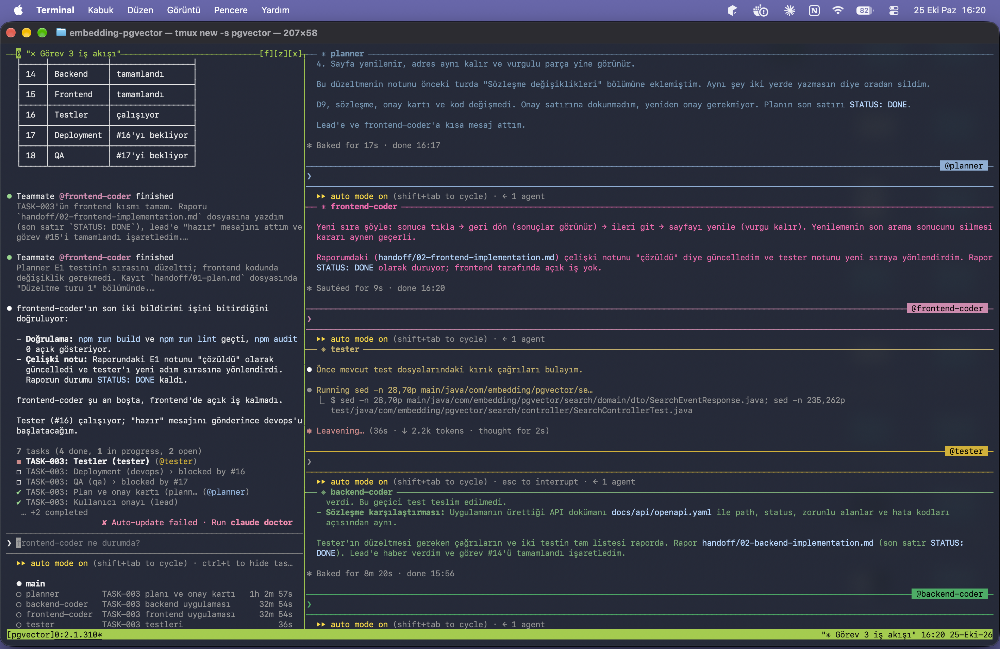

[Video 1: Ekran Kaydı 2026-10-26 15.14.40](kaynaklar/Ekran%20Kayd%C4%B1%202026-10-26%2015.14.40.mov)

[Video 2: Ekran Kaydı 2026-10-26 15.40.25](kaynaklar/Ekran%20Kayd%C4%B1%202026-10-26%2015.40.25.mov)

## Agent ekibi

| Sıra | Agent | Model | Görev |
|------|-------|-------|-------|
| 1 | `planner` | opus | Task'ı analiz eder; onay kartını ve teknik planı yazar, gerekirse `docs/api/` sözleşmesini günceller. Kod yazmaz. |
| 2 | `backend-coder` | opus | Planın backend kısmını Spring Boot ile uygular. Sadece `backend/` altına yazar, test yazmaz. |
| 2 | `frontend-coder` | opus | Planın frontend kısmını React ile uygular. Sadece `frontend/` altına yazar, test yazmaz. |
| 3 | `tester` | sonnet | Backend (JUnit) ve frontend (Vitest, Playwright) testlerini yazar ve çalıştırır. |
| 4 | `devops` | sonnet | Dockerfile ve docker-compose dosyalarını yazar, sistemi ayağa kaldırıp smoke kontrolü yapar. |
| 5 | `qa` | sonnet | Bağımsız son kontrol: değişiklikleri task'a ve sözleşmeye karşı denetler, mutation ve uçtan uca testleri çalıştırır. |

Tanımlar `.claude/agents/` altındadır. `backend-coder` ve `frontend-coder` paralel çalışır.

# Embedding ve pgvector

Embedding, vektör benzerliği ve PostgreSQL'de pgvector ile vektör aramayı anlatan, bunları çalışan bir demoyla gösteren eğitim projesi.

**Gereksinimler:** Docker Desktop, Ollama. Local geliştirme için ayrıca Java 26 ve Node 26.

## 1. Ollama

Ollama Docker'da değil, bilgisayarında çalışır. Backend (Docker'daki de local'deki de) ona `localhost:11434` üzerinden bağlanır.

```bash
brew install ollama                  # ya da https://ollama.com adresinden indir
brew services start ollama           # arka planda başlat (alternatif: ayrı terminalde `ollama serve`)
ollama pull bge-m3                   # embedding modeli, ~1,2 GB
curl -s localhost:11434/api/tags     # listede bge-m3 görünmeli
```

## 2. Çalıştırma

İki kurulum aynı portları kullanır, aynı anda çalışmaz. Birini başlatmadan önce diğerini `down` ile durdur. Komutları repo kökünden çalıştır.

### Docker Compose (tam sistem)

Her şey Docker'da çalışır: postgres, backend, frontend, pgadmin.

```bash
docker compose -f deployment/docker-compose.yml up --build -d   # başlat
docker compose -f deployment/docker-compose.yml ps              # 4 servis healthy olmalı (~1 dk)
docker compose -f deployment/docker-compose.yml down            # durdur (veri kalır)
docker compose -f deployment/docker-compose.yml down -v         # durdur ve veriyi sil
```

Site: http://localhost:3000

### Local Compose (geliştirme)

Docker'da sadece postgres ve pgadmin çalışır; backend ve frontend bilgisayarında.

```bash
docker compose -f deployment/docker-compose.dev.yml up -d       # postgres + pgadmin

cd backend && ./mvnw spring-boot:run                            # terminal 1 → :8080
cd frontend && npm ci && npm run dev                            # terminal 2 → :5173
```

Durdurmak için: `docker compose -f deployment/docker-compose.dev.yml down` (veriyi silmek için sonuna `-v`).

Site: http://localhost:5173

### Adresler

| Ne | Adres | Giriş |
|----|-------|-------|
| Swagger UI | http://localhost:8080/swagger-ui.html | — |
| pgAdmin | http://localhost:5050 | `admin@example.com` / `admin-local` (DB şifresi: `embedding-local`) |
| Veritabanı | `localhost:5432/embedding_pgvector` | `embedding` / `embedding-local` |

Denemek için örnek belge: `kaynaklar/ornek-dokuman/Atlaskap-Lojistik-Surec-El-Kitabi.pdf`. Sitede **Belge yükle** ile yükle, sonra örneğin "Yıllık izin kaç gün?" diye sor.

## 3. tmux ile agent ekibi

Task'lar Claude Code agent ekibiyle yürür; her agent kendi tmux panelinde açılır. macOS Terminal ya da iTerm2 kullan (VS Code terminali ve Ghostty'de paneller açılmaz).

```bash
brew install tmux                    # bir kez
cd ~/Documents/embedding-pgvector
tmux new -s pgvector                 # oturumu aç
claude                               # lead oturumu
```

Lead'e yaz: `docs/tasks/TASK-XXX/TASK.md için akışı başlat`

| Komut | Ne yapar |
|-------|----------|
| `Ctrl+b` → ok tuşları | Paneller arasında geçiş |
| `Ctrl+b` → `z` | Paneli tam ekran yap / geri al |
| `Ctrl+b` → `d` | Oturumdan ayrıl (ekip çalışmaya devam eder) |
| `tmux attach -t pgvector` | Oturuma geri dön |
| `claude --resume` | Önceki Claude oturumuna devam et (tmux içinde) |

Ayrıntılar: `KULLANIM-KILAVUZU.md` (agent ekibi), `ollama.md` (Ollama ve API denemeleri).
